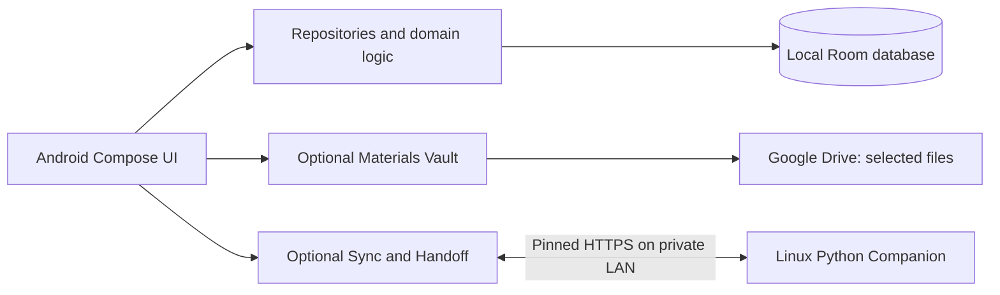

# Riko Hub

**An offline-first command center for study, plans, and work across Android and Linux.**

<kbd>Android · Kotlin + Compose</kbd> <kbd>Linux Companion · Python</kbd> <kbd>Active development</kbd>

[Start here](docs/handbook/00_START_HERE.md) · [Features](docs/handbook/01_FEATURES.md) · [Roadmap](docs/handbook/02_ROADMAP.md) · [Contribute](docs/handbook/06_CONTRIBUTING.md)

Riko Hub helps a person capture a task, see what matters today, keep course materials close, and resume selected work on a trusted laptop. The Android planner keeps its core records locally. Google Drive is optional for selected materials; the Linux Companion is an optional, explicitly paired extension. Neither is required to plan offline.

The project aims to reduce the steps between **capture → organize → act → resume**. It is a personal productivity tool with academic workflows, not a general-purpose workspace builder or a Notion clone. The current interface is a working foundation; a total visual redesign is being explored and has not been approved or implemented.

## What you can explore

| Area | Today’s source | Evidence boundary |
|---|---|---|
| Local planning | Tasks, Home urgency/focus, Timeline, reminders, widget, backup | v0.2 was owner accepted; later changes need fresh checks. |
| Materials Vault | Google Drive selection, browsing and file actions | v0.3 source exists; live Drive QA is pending. |
| Laptop Companion | LAN discovery, pairing, recent presence and terminal dashboard | v0.4 source exists; cross-device acceptance is pending. |
| Universal Handoff | Selected LAN file/text transfer and workspace metadata | Bounded v0.5 source exists; build and device behavior remain unverified. |
| Academic work | Course and assignment source in the working tree | v0.6 work is unverified and unreleased. |

See the [feature catalog](docs/handbook/01_FEATURES.md) for user problems, modules and exact status labels. Source presence is never treated as proof of a successful build or a released feature.

## Where it is going

The proposed [roadmap](docs/handbook/02_ROADMAP.md) extends the Companion beyond the LAN, deepens handoff, and connects courses, documents, evidence and local automation. Later milestones target a unified daily workspace and a reliability-focused v1.0. These are plans, with separate owner decisions and acceptance gates.

## How the pieces fit

The Android app is one Gradle `:app` module using Kotlin, Jetpack Compose, Room, DataStore and WorkManager. The Linux Companion uses Python 3.11+, `cryptography` and `zeroconf`, with a foreground CLI and terminal dashboard. [Architecture](docs/handbook/03_ARCHITECTURE.md) explains the trust boundary and what remains proposed.

## Screenshots

Verified current screenshots are not included yet. This space is reserved for owner-reviewed captures of the Android UI and Companion dashboard; the planned redesign should not be represented by mockups as shipped UI.

## Get started

- [New team member orientation](docs/handbook/00_START_HERE.md)
- [Android and Linux setup](docs/handbook/05_GETTING_STARTED.md)
- [Project map](docs/handbook/04_PROJECT_STRUCTURE.md)
- [Design direction](docs/handbook/07_DESIGN_DIRECTION.md) and [glossary](docs/handbook/08_GLOSSARY.md)
- [Current status](docs/STATUS.md) and [Renaissance planning suite](docs/renaissance/00_README.md)

Contributions are welcome: start with the [contributing guide](docs/handbook/06_CONTRIBUTING.md), keep changes focused, and bring architectural or design proposals to the Project Owner for review.

> **Maturity:** Riko Hub is in active development and has no public stable release documented here. Historical checks and owner reports are recorded in [STATUS](docs/STATUS.md); this README does not certify the current working tree, device behavior or future roadmap milestones.
