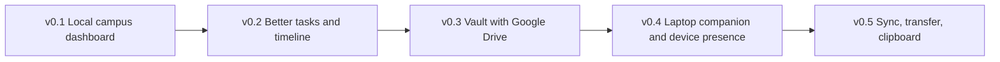

# 00 - Product Vision (Product Constitution)

This document outranks every other file on questions of "what is this product".

## 1. What Riko Hub is

Riko Hub is a **personal campus and life control center** for one person, Riko, a university student in Indonesia. It collects academic, organizational, personal and project obligations in one place and answers one question the moment the app opens:

> "What matters right now?"

It is a small personal operating system for surviving university life.

## 2. The problem

Riko's obligations overlap and arrive unpredictably:

- classes, practicum, assignments, UTS/exams, presentations
- organization duties (evaluation sessions, cohort events, talkshows, community service)
- sudden campus obligations that appear mid-week
- personal reminders (eat, drink water, rest, money errands)
- coding, game-dev and cybersecurity projects
- files scattered across phone, laptop and Google Drive

The cost is not forgetting one task. The cost is **mental clutter**: re-assembling the whole picture in his head every time. Existing tools feel like heavy project management (Notion, Trello) or generic checklists that treat "drink water" and "UTS tomorrow" as the same thing.

## 3. Target user

| Attribute | Value |
|-----------|-------|
| Who | Exactly one person: Riko |
| Context | Student, phone-first, often one-handed, often between classes |
| Language | Bahasa Indonesia UI |
| Device | Own Android phone; own laptop later |
| Tolerance | Low for setup and ceremony. High appreciation for personality. |

Design for Riko's real week, not a hypothetical market.

## 4. Product philosophy

1. **Glanceable first.** The first screen is understandable in under 3 seconds without reading paragraphs.
2. **Urgency is spatial.** On Home, size and position carry priority, so fewer labels are needed.
3. **Contrast between screens.** Home is playful and organic. Other screens are calm and structured. One family, not clones.
4. **Local-first.** The phone database is the source of truth. The app works with no internet.
5. **Honest.** Never show fake sync, fake online status or fake files. Unfinished features say they are unfinished.
6. **Small and felt.** Every release changes how the app feels to use. No invisible architecture-only releases.
7. **Personal, not corporate.** Warm, student-made, indie.
8. **Private.** Single-user, no accounts, no analytics, no social features.

## 5. Life domains

| Enum key | Indonesian label | Examples |
|----------|------------------|----------|
| `ACADEMIC` | Akademik | assignments, classes, practicum, UTS, presentations, deadlines |
| `ORGANIZATION` | Organisasi | evaluations, socialization, cohort events, community service, talkshows, sudden duties |
| `PERSONAL` | Personal | meals, water, rest, errands, money reminders, simple goals |
| `PROJECTS` | Project | coding, game dev, cybersecurity, competitions, experiments |

Domains share one data model and one Home, but each has its own accent color and subtle shape cue (see `07`). They MUST NOT feel identical.

## 6. What makes it different

| Typical app | Riko Hub |
|-------------|----------|
| Bottom tab bar, identical cards | Spatial navigation centered on Home; varied shapes |
| Priority shown with labels and colored chips | Priority shown by size and position on Home |
| One visual language everywhere | Deliberate contrast: expressive Home, calm elsewhere |
| Generic categories | Four real domains from Riko's life |
| Cloud account first | Local-first, no account, no network in v0.1 |
| Metrics dashboard | One answer: what matters now |

## 7. What the app MUST NOT become

- A Notion clone (no blocks, databases, wikis)
- A Trello clone (no boards or kanban as the primary model)
- A generic todo app with a pastel skin
- A corporate or SaaS admin dashboard
- A fintech-style dashboard
- A school LMS
- A heavy ERP system
- A social or competitive product (no feeds, profiles, leaderboards, streak shaming)
- A luxury product. The earlier black-and-gold prototype is rejected as an identity.
- A childish gamified toy. Playful, not childish.

## 8. Long-term vision

| Component | Long-term role |
|-----------|----------------|
| Google Drive | Primary file vault |
| Laptop | Workspace and large cache |
| Phone | Control center and lightweight cache |

The phone never needs to hold all files.

## 9. MVP definition (Riko Hub v0.1)

v0.1 is done when Riko can run his real week from it, offline.

**In scope**

| Area | Included |
|------|----------|
| Home | date, greeting, today's focus, today's progress, bubble priority view, completion interaction, quick add |
| Tasks | list grouped by time bucket, category filter, create / edit / delete (with undo), status, priority, deadline, notes |
| Timeline | chronological view of events, task deadlines and completed work; minimal event creation |
| Data | Room persistence, soft delete |
| Settings | theme mode (system/light/dark), display name, navigation style |
| Navigation | spatial gestures plus a visible compass alternative |
| Vault / Sync | **Honest placeholder screens** that preserve the navigation map. No fake data. |

**Out of scope for v0.1 (MUST NOT build)**

Google Drive, laptop sync, accounts or authentication, clipboard sync, realtime networking, any server backend, push notifications, recurring items, widgets, import/export.

## 10. Success test

Riko opens the app between two classes. Within 3 seconds he knows the one thing to do next, can add a surprise task in under 10 seconds with one thumb, and trusts that nothing he entered is lost.

## 11. Product decisions already made (do not reopen)

| Decision | Choice |
|----------|--------|
| Identity | Warm, colorful, indie. Not black-and-gold. |
| Navigation | Spatial around Home, plus visible alternative |
| Screen layout | Home: Timeline above, Tasks below, Sync left, Vault right |
| Bubbles | Home only |
| Backend | None in v0.1 |
| Accounts | None, ever, unless Miyu asks |
