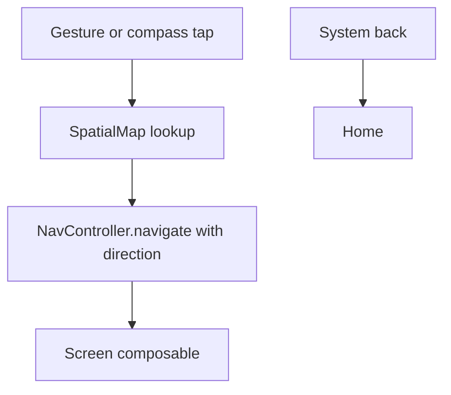

# 02 - Android Architecture

Labels: **REQUIRED** = must follow. **RECOMMENDED** = default, deviate with reason in `STATUS.md`.

## 1. Stack

| Concern | Choice | Level |
|---------|--------|-------|
| Language | Kotlin | REQUIRED |
| UI | Jetpack Compose | REQUIRED |
| Design system | Material 3, heavily customized (custom shapes, colors, typography, not default look) | REQUIRED |
| Navigation | Navigation Compose, wrapped by a spatial gesture layer | REQUIRED |
| Persistence | Room (KSP) | REQUIRED |
| Preferences | DataStore (Preferences) | REQUIRED |
| Background | WorkManager (declared in v0.1 setup, used minimally) | REQUIRED to include; usage RECOMMENDED to be minimal |
| Async | Kotlin coroutines + Flow | REQUIRED |
| DI | **Manual** (a simple `AppContainer` in the `Application` class) | RECOMMENDED. No Hilt/Koin in v0.1. |
| Build | Gradle Kotlin DSL + version catalog (`libs.versions.toml`) | REQUIRED |
| minSdk | 26 | RECOMMENDED |
| targetSdk / compileSdk | Latest stable at project creation | REQUIRED |
| Single module | `:app` only | REQUIRED for v0.1 |

Use current stable library versions at project creation; pin them in the version catalog. Do not use alpha/beta unless a feature requires it, and record the reason.

## 2. Package layout

Base package: `id.riko.hub` (RECOMMENDED; Astra MAY change if the user specifies).

```
app/src/main/java/id/riko/hub/
├── RikoHubApp.kt                 // Application, holds AppContainer
├── MainActivity.kt               // single activity, edge-to-edge
├── core/
│   ├── time/                     // Clock abstraction, date helpers, WITA-safe formatters
│   ├── result/                   // AppResult / error wrappers (small)
│   └── util/
├── data/
│   ├── local/
│   │   ├── RikoDatabase.kt
│   │   ├── dao/                  // TaskDao, EventDao
│   │   ├── entity/               // TaskEntity, EventEntity
│   │   └── converter/            // enum converters
│   ├── repository/               // TaskRepository, EventRepository (impls)
│   ├── prefs/                    // SettingsDataStore
│   └── mapper/                   // Entity <-> domain
├── domain/
│   ├── model/                    // Task, Event, Category, Priority, Status, EventKind
│   ├── repository/               // interfaces (RECOMMENDED, see §4)
│   └── logic/                    // UrgencyCalculator, TaskGrouping, BubbleLayoutPlanner
├── ui/
│   ├── theme/                    // Color, Type, Shape, Theme, Motion tokens
│   ├── components/               // shared small composables
│   ├── home/                     // HomeScreen, HomeViewModel, HomeUiState, bubble/
│   ├── tasks/
│   ├── timeline/
│   ├── vault/                    // placeholder
│   ├── sync/                     // placeholder
│   ├── settings/
│   └── compass/                  // CompassChip, SpatialNavLayer
├── navigation/
│   ├── Destinations.kt
│   ├── SpatialMap.kt             // grid coordinates of each destination
│   └── RikoNavHost.kt
└── work/                         // WorkManager workers (empty or minimal in v0.1)
```

Rules:
- `domain/logic` MUST be pure Kotlin (no Android imports) so it is unit-testable.
- No file over ~300 lines (RECOMMENDED). A composable file over ~200 lines SHOULD be split.
- Do not create layers without a purpose. No UseCase classes unless a function is reused by 2+ ViewModels (RECOMMENDED).

## 3. Major models (domain)

| Model | Fields (summary, details in `03`) |
|-------|-----------------------------------|
| `Task` | id, title, notes, category, priority, status, deadlineAt?, createdAt, updatedAt, completedAt?, syncId |
| `Event` | id, title, notes, kind, category, startAt, endAt?, location?, createdAt, updatedAt, syncId |
| `Category` | enum `ACADEMIC, ORGANIZATION, PERSONAL, PROJECTS` |
| `Priority` | enum `LOW, MEDIUM, HIGH` |
| `TaskStatus` | enum `NOT_STARTED, IN_PROGRESS, DONE` |
| `EventKind` | enum `CLASS, EXAM, MEETING, ACTIVITY, NOTE, OTHER` |
| `UrgencyInfo` | taskId, score, tier (XL/L/M/S), isOverdue |
| `AppSettings` | themeMode, displayName, navStyle, hintsShownCount |

## 4. Repositories

- `TaskRepository` and `EventRepository` interfaces live in `domain/repository` (RECOMMENDED) with Room-backed implementations in `data/repository`. Interfaces exist mainly to allow fakes in tests and a future sync-aware implementation.
- Repositories expose `Flow` for reads and `suspend` for writes.
- Repositories map entities to domain models. Entities MUST NOT leak into the UI.
- Repositories MUST NOT hold UI state.

Minimum `TaskRepository` API:

```
observeActive(): Flow<List<Task>>            // not deleted, not done
observeAll(): Flow<List<Task>>               // not deleted
observeById(id): Flow<Task?>
upsert(task): suspend
setStatus(id, status): suspend               // also sets/clears completedAt
softDelete(id): suspend
restore(id): suspend                         // undo
```

Minimum `EventRepository` API:

```
observeBetween(startMs, endMs): Flow<List<Event>>
observeById(id)
upsert(event), softDelete(id), restore(id)
```

## 5. DAO responsibilities

DAOs contain **queries only**. No business logic.

- `TaskDao`: select by deleted flag, by deadline range, by status; insert/update; set `deletedAt`.
- `EventDao`: select between times (overlap-aware: `startAt < :end AND COALESCE(endAt, startAt) >= :start`).
- All read queries return `Flow`.
- Soft-deleted rows MUST be excluded by every read query except explicitly named admin/cleanup ones.

## 6. ViewModels and UI state

One ViewModel per major screen. Use `StateFlow<UiState>` exposed with `stateIn(viewModelScope, SharingStarted.WhileSubscribed(5_000), initial)`.

| ViewModel | UiState highlights |
|-----------|--------------------|
| `HomeViewModel` | greeting data, progress (done/total today), `List<BubbleUi>`, focusTaskId, nextObligation?, mode (CALM/NORMAL/DENSE), overflowCount |
| `TasksViewModel` | selected filter, grouped buckets, expanded states, undo request |
| `TimelineViewModel` | selected week, day sections with stops |
| `TaskEditorViewModel` | form state, validation errors, save state |
| `SettingsViewModel` | settings snapshot |

Rules:
- UiState classes are immutable `data class` / sealed interfaces.
- One-time effects (snackbars, navigation) use a `SharedFlow`/`Channel` of events, or a state field consumed by the UI. Choose one pattern and keep it consistent.
- ViewModels take repositories and a `Clock` via constructor. A `ViewModelProvider.Factory` built from `AppContainer` is RECOMMENDED.
- Composables receive state and lambdas, not ViewModels, whenever practical (easier previews).

## 7. Navigation model

- Five destinations in `Destinations.kt`: `Home`, `Tasks`, `Timeline`, `Vault`, `Sync`. `Settings` and editors are not part of the spatial map (sheets or secondary route).
- `SpatialMap.kt` defines grid coordinates:

```
Home      (0, 0)
Tasks     (0, +1)   // below
Timeline  (0, -1)   // above
Vault     (+1, 0)   // right
Sync      (-1, 0)   // left
```

- `SpatialNavLayer` (REQUIRED) is a composable that:
  1. Detects drag gestures on Home and, where allowed, on other screens (rules in `01` §6).
  2. Converts a gesture direction to a target destination via `SpatialMap`.
  3. Calls `navController.navigate(...)` with `launchSingleTop`, and `popUpTo(Home)`.
- Directional enter/exit transitions come from the source and target coordinates (compute `slideIntoContainer` direction from the delta).
- System back from any non-Home destination MUST navigate to Home. Back on Home exits the app.
- The compass chip calls the same navigation function.



## 8. Coroutines

- ViewModels launch in `viewModelScope`.
- Repository/DAO suspend functions are main-safe (Room handles dispatch); no manual `Dispatchers.IO` for Room calls.
- Inject a `CoroutineDispatcher` only if a class does heavy CPU work (the layout planner is cheap; no need).
- Never use `GlobalScope`.
- A `Clock` interface in `core/time` provides `now()` and `zone()`; tests supply a fixed clock. Home ticks time every 60 seconds via a flow that re-emits (for "overdue" transitions).

## 9. Error handling

- DB writes wrapped in `try/catch` in the ViewModel or repository, surfaced as `UiMessage` events.
- Use a small `AppResult<T>` (`Success`/`Failure`) only at repository boundaries that can fail meaningfully. Do not wrap every function.
- Never swallow exceptions silently. Log with `Log.e(TAG, msg, e)`.
- Do not show stack traces to the user.
- Do NOT add crash-reporting SDKs (privacy).

## 10. Theme architecture

```
ui/theme/
├── Color.kt        // palette constants + light/dark ColorScheme builders
├── RikoColors.kt   // extra semantic colors via CompositionLocal (domain accents, urgent, bubble fills)
├── Type.kt         // Nunito + Fredoka font families, Typography
├── Shape.kt        // Shapes + custom named shapes (BlobShapes, AsymmetricShapes)
├── Motion.kt       // durations, easings, springs, reduced-motion helper
├── Spacing.kt      // spacing constants
└── Theme.kt        // RikoHubTheme(darkTheme, content)
```

- Use `MaterialTheme` as the base, but extend it with `LocalRikoColors` for semantic accents. Screens MUST NOT hardcode hex values; they use tokens.
- Do NOT enable Material You dynamic color by default (the identity is custom). MAY be added as a setting later.
- Fonts: bundle Nunito and Fredoka in `res/font` (OFL licensed). Include license files in `/licenses`.

## 11. Settings (DataStore)

Keys: `theme_mode` (SYSTEM/LIGHT/DARK), `display_name` (default "Riko"), `nav_style` (SPATIAL_COMPASS / COMPASS_ONLY), `hints_shown_count`, `pinned_focus_task_id`, `pinned_focus_date`.

## 12. WorkManager (v0.1)

Include the dependency and an `ExampleWorker`-free setup. In v0.1 the only OPTIONAL use is a daily cleanup of tasks soft-deleted more than 30 days ago. If not implemented, leave a TODO in `work/`.

## 13. Dependencies policy

Allowed in v0.1: Compose BOM, Material 3, Navigation Compose, Lifecycle (viewmodel-compose, runtime-compose), Room (runtime, ktx, compiler via KSP), DataStore Preferences, WorkManager, Kotlin coroutines, JUnit, Turbine (optional), AndroidX test + Compose UI test.

Disallowed without written justification: Hilt/Dagger, Koin, Retrofit, OkHttp, Coil, Firebase, any analytics, any ads, Accompanist (use platform APIs), Lottie.

## 14. Future expansion points

| Future feature | Where it plugs in |
|----------------|-------------------|
| Google Drive | New `data/remote/drive` + `VaultRepository`; `ui/vault` already exists |
| Laptop companion | New `data/remote/device` + `DeviceRepository`; `ui/sync` |
| Sync engine | `syncId` and `updatedAt`/`deletedAt` already on entities; add `SyncQueue` table in a later migration |
| Recurring tasks | New table or fields via migration; not now |
| Notifications | `work/` + notification channel; not now |
| Multi-module | Only if the project exceeds practical single-module size |

## 15. Required vs recommended summary

| Item | Level |
|------|-------|
| Compose, Room, DataStore, Navigation Compose, WorkManager | REQUIRED |
| Domain logic pure Kotlin | REQUIRED |
| Entities not leaking to UI | REQUIRED |
| No hardcoded colors in screens | REQUIRED |
| Back to Home behavior | REQUIRED |
| Manual DI | RECOMMENDED |
| Repository interfaces | RECOMMENDED |
| `AppResult` | RECOMMENDED |
| Package name `id.riko.hub` | RECOMMENDED |
