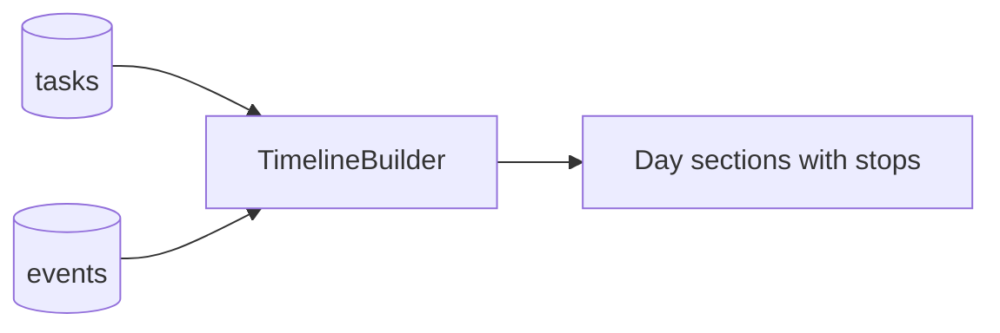

# 03 - Data Model (Local Database v1)

Database: Room, name `riko_hub.db`, **version 1**, `exportSchema = true` (schemas stored in `app/schemas/`).

## 1. Key decisions

| Question | Decision | Justification |
|----------|----------|---------------|
| Category: enum or entity? | **Enum** (`ACADEMIC, ORGANIZATION, PERSONAL, PROJECTS`) stored as TEXT | The four domains are a product constitution, not user data. Each has a hardcoded accent and shape cue in the UI. A table adds joins, seeding and migrations for no benefit. If Riko ever wants custom categories, add a `CategoryEntity` in a later migration and map the enum to seed rows. |
| DailyFocus entity? | **No table in v0.1** | Focus is computed (`08`). A manual pin is stored in DataStore (`pinned_focus_task_id`, `pinned_focus_date`). Avoids a table with one row per day. |
| Delete strategy | **Soft delete** via `deletedAt` | Needed for undo, and keeps future sync from losing deletions. A cleanup worker MAY hard-delete rows soft-deleted over 30 days. |
| Time storage | **Epoch milliseconds (UTC) as `Long`** | Zone-independent. Convert using the device zone at display and grouping time. |
| IDs | **`Long` autoGenerate primary key** + `syncId` UUID string | Simple and fast locally. `syncId` is generated now (unused) so later sync does not need to rewrite rows. |
| Enums in DB | Stored as `String` names | Safe to reorder enum entries. Add values only; never rename existing without a migration. |

## 2. Entities

### 2.1 `TaskEntity` (table `tasks`)

| Column | Type | Null | Default | Notes |
|--------|------|------|---------|-------|
| `id` | INTEGER PK autoincrement | no | | |
| `syncId` | TEXT | no | random UUID | Unique. Unused in v0.1. |
| `title` | TEXT | no | | 1 to 120 chars, trimmed |
| `notes` | TEXT | yes | null | Up to 2000 chars |
| `category` | TEXT | no | `PERSONAL` | Enum name |
| `priority` | TEXT | no | `MEDIUM` | `LOW/MEDIUM/HIGH` |
| `status` | TEXT | no | `NOT_STARTED` | `NOT_STARTED/IN_PROGRESS/DONE` |
| `deadlineAt` | INTEGER | yes | null | UTC ms. Date-only deadlines are stored as local 23:59 of that day. |
| `hasDeadlineTime` | INTEGER (bool) | no | 0 | True if the user chose a specific time; used only for display wording |
| `createdAt` | INTEGER | no | now | |
| `updatedAt` | INTEGER | no | now | Set on every write |
| `completedAt` | INTEGER | yes | null | Set when status becomes DONE, cleared otherwise |
| `deletedAt` | INTEGER | yes | null | Soft delete marker |

Invariants (enforced in repository, tested):
- `status == DONE` iff `completedAt != null`.
- `updatedAt >= createdAt`.
- `title` non-blank.
- Un-deleting restores `deletedAt = null` and updates `updatedAt`.

Indexes:
- `index_tasks_deadline` on (`deadlineAt`)
- `index_tasks_status_deleted` on (`status`, `deletedAt`)
- `index_tasks_syncId` UNIQUE on (`syncId`)

### 2.2 `EventEntity` (table `events`)

| Column | Type | Null | Default | Notes |
|--------|------|------|---------|-------|
| `id` | INTEGER PK autoincrement | no | | |
| `syncId` | TEXT | no | random UUID | Unique |
| `title` | TEXT | no | | |
| `notes` | TEXT | yes | null | |
| `kind` | TEXT | no | `OTHER` | `CLASS/EXAM/MEETING/ACTIVITY/NOTE/OTHER` |
| `category` | TEXT | no | `ACADEMIC` | Same enum as tasks |
| `startAt` | INTEGER | no | | UTC ms |
| `endAt` | INTEGER | yes | null | Must be `>= startAt` when set |
| `location` | TEXT | yes | null | Free text |
| `createdAt` | INTEGER | no | now | |
| `updatedAt` | INTEGER | no | now | |
| `deletedAt` | INTEGER | yes | null | |

Indexes:
- `index_events_start` on (`startAt`)
- `index_events_syncId` UNIQUE on (`syncId`)

### 2.3 Relationships

None enforced in v0.1. Events and tasks are independent. The Timeline merges them in the domain layer:



A future optional link (`Task.eventId`) MAY be added via migration, e.g., "assignment from this class".

## 3. Type converters

- Enums: convert via explicit `String` columns using `@TypeConverter` pairs, or store `String` in the entity and map in the mapper. RECOMMENDED: entity fields are `String`; mappers convert with `valueOf` guarded by a fallback (unknown value maps to a safe default and logs a warning). This makes rolling back or adding enum values safe.

## 4. Time handling rules

| Rule | Detail |
|------|--------|
| Storage | UTC epoch ms |
| "Today" boundaries | Computed with `ZoneId.systemDefault()` (Riko is in WITA, UTC+8, but never hardcode it) |
| Clock | Use `core/time/Clock` everywhere. Never call `System.currentTimeMillis()` in logic. |
| Date-only deadline | Local 23:59:00 of that date |
| Bucket definitions | Terlambat: deadline < now and not done. Hari ini: deadline today. Besok: tomorrow. Minggu ini: next 2 to 7 days. Nanti: beyond. No deadline: lands in "Nanti". |
| Week definition for Timeline | Monday to Sunday (Indonesian convention) |

## 5. Queries (reference)

```sql
-- active tasks (home, tasks)
SELECT * FROM tasks WHERE deletedAt IS NULL AND status != 'DONE' ORDER BY deadlineAt IS NULL, deadlineAt ASC

-- all non-deleted tasks
SELECT * FROM tasks WHERE deletedAt IS NULL

-- tasks completed in range (timeline)
SELECT * FROM tasks WHERE deletedAt IS NULL AND status = 'DONE' AND completedAt BETWEEN :start AND :end

-- tasks with deadline in range (timeline)
SELECT * FROM tasks WHERE deletedAt IS NULL AND deadlineAt BETWEEN :start AND :end

-- events overlapping a range
SELECT * FROM events WHERE deletedAt IS NULL AND startAt <= :end AND COALESCE(endAt, startAt) >= :start ORDER BY startAt
```

## 6. Migration strategy

| Rule | Detail |
|------|--------|
| Schema export | `exportSchema = true`, commit `app/schemas/` |
| Writing migrations | Every version bump gets an explicit `Migration(from, to)` with SQL |
| Destructive fallback | **MUST NOT** be enabled in release builds. MAY be enabled in debug only if documented. |
| Testing | Use `MigrationTestHelper` for each migration from v2 onward |
| Additive first | Prefer adding nullable columns / new tables |

Planned future migrations (do NOT implement now):

| Version | Change |
|---------|--------|
| 2 | Possibly `tasks.eventId`, `tasks.estimatedMinutes` |
| 3 | `vault_files` (cached Drive metadata), `offline_marks` |
| 4 | `devices`, `transfers` |
| 5 | `sync_queue` (entity type, syncId, operation, payload, createdAt) |

## 7. Seed data

- Release builds MUST start empty.
- Debug builds MAY include a `DebugSeeder` (behind `BuildConfig.DEBUG`) with realistic Indonesian sample data matching Riko's life (e.g., "Persiapan UTS Sistem Informasi", "Tugas Individu Basis Data", "Evaluasi Program Kerja Divisi Acara", "Minum air").
- Compose previews use in-code fake data, not the database.

## 8. Validation rules (shared)

| Field | Rule |
|-------|------|
| Task title | required, trimmed, max 120 |
| Task notes | max 2000 |
| Event title | required, max 120 |
| Event end | not before start |
| Deadline | any date allowed, including past (it will show as Terlambat) |

## 9. Domain models and mapping

Domain `Task` mirrors the entity but with real enums and `Instant`/`Long` times (RECOMMENDED: keep `Long` ms in domain to avoid conversions; format at the UI edge).

## 10. Privacy

No analytics or identifiers are stored beyond what is above. Database is private to the app (`allowBackup=false` in the manifest for v0.1 until a deliberate backup strategy exists).
