# 04 - Roadmap

Every phase is independently buildable and testable. The project MUST build and run after each phase. Do not start a phase before the previous one meets its acceptance criteria.

```mermaid
flowchart LR
  P0[Phase 0 Init] --> P1[Phase 1 Theme + nav shell]
  P1 --> P2[Phase 2 Room]
  P2 --> P3[Phase 3 Task CRUD]
  P3 --> P4[Phase 4 Home]
  P4 --> P5[Phase 5 Timeline]
  P5 --> P6[Phase 6 Polish + release v0.1]
  P6 --> F1[v0.2 Better tasks/timeline]
  F1 --> F2[v0.3 Vault + Drive]
  F2 --> F3[v0.4 Laptop companion]
  F3 --> F4[v0.5 Sync]
```

---

## Phase 0 - Project initialization

**GOAL** An empty but correct Android project that builds and installs.

**FILES / COMPONENTS EXPECTED**
- Gradle Kotlin DSL, `libs.versions.toml`, `:app` module
- `RikoHubApp`, `MainActivity` (edge-to-edge)
- Package skeleton from `02` §2 (empty packages may contain a `package-info`-style placeholder file or the first real file)
- `.gitignore`, `README` of the app (short)
- The `docs/` folder containing all spec `.md` files and `STATUS.md`

**WHAT ASTRA SHOULD BUILD**
1. Project with Compose, Material 3, Navigation Compose, Room (KSP), DataStore, WorkManager dependencies declared.
2. A placeholder screen showing "Riko Hub".
3. Debug and release build types; release minify OFF for now.
4. `allowBackup=false`.

**ACCEPTANCE CRITERIA**
- `./gradlew assembleDebug` succeeds.
- App launches on an emulator/device without crash.
- Spec files are in `docs/`.

**WHAT NOT TO BUILD YET** Theme, navigation, database, any real screen.

---

## Phase 1 - Theme and navigation shell

**GOAL** The app looks like Riko Hub and the spatial navigation works with empty screens.

**FILES / COMPONENTS EXPECTED**
- `ui/theme/*` (Color, RikoColors, Type, Shape, Motion, Spacing, Theme)
- Fonts in `res/font`
- `navigation/Destinations.kt`, `SpatialMap.kt`, `RikoNavHost.kt`
- `ui/compass/CompassChip.kt`, `SpatialNavLayer.kt`
- Five placeholder screens each with a distinct layout sketch (not the same template)
- A tiny preview-only component gallery (Compose previews)

**WHAT ASTRA SHOULD BUILD**
1. Light and dark themes from `07`.
2. Directional transitions between destinations.
3. Gesture navigation on Home with edge-exclusion; compass chip on all screens.
4. System back returns to Home.
5. Settings route stub (opened from Home header action) with theme toggle only (wired to DataStore if trivial, otherwise in Phase 6).

**ACCEPTANCE CRITERIA**
- Swipe up/down/left/right on Home reaches Tasks/Timeline/Vault/Sync respectively.
- Compass chip reaches every destination; TalkBack labels exist.
- Back from any screen returns to Home.
- Light and dark both render without unreadable text.
- Reduced-motion setting switches slides to fades.
- Preview gallery compiles.

**WHAT NOT TO BUILD YET** Database, real content, bubbles.

---

## Phase 2 - Room database

**GOAL** Persistence layer exists and is tested.

**FILES / COMPONENTS EXPECTED**
- `data/local/entity/*`, `dao/*`, `RikoDatabase`
- `data/mapper/*`, `domain/model/*`
- `data/repository/*` and `domain/repository/*`
- `core/time/Clock`
- `AppContainer` wiring
- `app/schemas/1.json`
- Tests (see `09`)

**WHAT ASTRA SHOULD BUILD**
1. Entities, indexes, DAOs per `03`.
2. Repositories with invariants (`completedAt`, `updatedAt`).
3. `DebugSeeder` for debug builds only.
4. DataStore `SettingsDataStore`.

**ACCEPTANCE CRITERIA**
- DAO instrumented tests pass (insert, query, soft delete, restore, status change).
- Invariant unit tests pass.
- Data survives process death on a debug seed run.
- No UI changes required.

**WHAT NOT TO BUILD YET** CRUD UI, Home logic.

---

## Phase 3 - Task CRUD

**GOAL** Riko can really manage tasks.

**FILES / COMPONENTS EXPECTED**
- `ui/tasks/*` (screen, ViewModel, UiState, row components, bucket headers, filter row)
- `ui/components/` task editor sheet, quick add sheet
- `domain/logic/TaskGrouping.kt` (+ tests)
- Snackbar/undo mechanism

**WHAT ASTRA SHOULD BUILD**
1. Tasks screen per `01` §8: filter, buckets, rows, swipe actions, checkbox.
2. Editor sheet with validation.
3. Soft delete with undo.
4. Empty and error states.

**ACCEPTANCE CRITERIA**
- Create, edit, complete, uncomplete, delete, and undo all work and persist after restart.
- Bucket logic unit tests pass (Terlambat, Hari ini, Besok, Minggu ini, Nanti).
- Filter works.
- Title validation blocks blank titles.
- Works at 200% font scale without clipped text.

**WHAT NOT TO BUILD YET** Home bubbles, Timeline, natural-language date parsing, recurring tasks.

---

## Phase 4 - Home visualization

**GOAL** The signature screen: urgency shown spatially.

**FILES / COMPONENTS EXPECTED**
- `domain/logic/UrgencyCalculator.kt`, `BubbleLayoutPlanner.kt` (+ tests)
- `ui/home/*`: screen, ViewModel, `BubbleField`, `Bubble`, blob shapes, greeting header, progress strip, next-obligation pill
- Quick add integration on Home
- Bubble peek sheet

**WHAT ASTRA SHOULD BUILD**
1. Everything in `08`, including calm/normal/dense modes, overflow bubble, focus selection and pin.
2. Completion animation and reflow.
3. TalkBack descriptions.
4. Idle drift (respecting reduced motion).

**ACCEPTANCE CRITERIA**
- Urgency unit tests cover every score rule in `08` §2.
- Layout planner tests: deterministic output for the same input; never more than 7 bubbles + overflow; no bubble outside the field.
- Completing a task updates Home immediately and progress advances.
- Zero urgent tasks shows calm mode.
- 6+ urgent tasks shows dense mode without overlap exceeding the limit.
- Home stays at 60fps on a mid-range device in manual check (no jank during drift).

**WHAT NOT TO BUILD YET** Physics engines, drag-to-reorder bubbles, bubble confetti.

---

## Phase 5 - Timeline

**GOAL** A readable, narrative week view.

**FILES / COMPONENTS EXPECTED**
- `domain/logic/TimelineBuilder.kt` (+ tests)
- `ui/timeline/*`: screen, ViewModel, path Canvas, stop panels, day labels, week switcher
- Event editor sheet

**WHAT ASTRA SHOULD BUILD**
1. Merge events, task deadlines and completed tasks per day.
2. Winding path with alternating stops; fallback to straight line when over 6 stops in a day.
3. Event create/edit/delete (with undo).
4. Auto-scroll to today.

**ACCEPTANCE CRITERIA**
- Builder tests: correct ordering, day grouping across midnight, multi-day events, week boundaries (Monday start).
- Tapping a stop opens the right editor.
- Past items muted; today highlighted.
- Empty week empty state appears.
- Readable at 200% font scale.

**WHAT NOT TO BUILD YET** Month view, calendar import, recurring events, drag to reschedule.

---

## Phase 6 - Polish and v0.1 release

**GOAL** Riko can run his real week with it.

**FILES / COMPONENTS EXPECTED**
- `ui/settings/*`
- Vault and Sync placeholder screens finalized per `01`
- App icon (adaptive), splash (Android 12+ splash API)
- Release signing config instructions
- Updated `CHANGELOG.md`, `STATUS.md`

**WHAT ASTRA SHOULD BUILD**
1. Settings: theme mode, display name, navigation style.
2. Edge hints behavior (fade after 3 launches).
3. Empty/loading/error states audit across all screens.
4. Accessibility pass (TalkBack walkthrough, contrast, font scale).
5. Performance pass (baseline checks).
6. Release APK built per `09`.

**ACCEPTANCE CRITERIA**
- Every item in `06_ACCEPTANCE_CRITERIA.md` is checked, or the failure is documented in `STATUS.md` with a reason.
- Release APK installs and runs offline.

**WHAT NOT TO BUILD YET** Anything from v0.2+.

---

## Future versions (planning only, do NOT build early)

### v0.2 - Better tasks and timeline
- **Goal:** Make the daily loop smoother.
- **Candidates:** recurring tasks, subtasks/checklists, estimated duration, local notifications for deadlines (WorkManager + notifications), widget showing top 3, search, Timeline day view.
- **Not yet:** any network feature.

### v0.3 - Vault and Google Drive
- **Goal:** Browse Drive from the phone.
- **Candidates:** Google sign-in (Credential Manager / Google Identity), Drive API read-only first, folder mapping (Kuliah, Projects, Personal, Inbox), recent files, search, open/temporary download, offline marks, cache cleanup, upload.
- **Constraints:** least-privilege OAuth scope (`drive.file` or app-specific folder first), local cache with size cap, Vault MUST still work offline for cached files.
- **Not yet:** laptop transfer.

### v0.4 - Laptop companion and device presence
- **Goal:** Phone knows the laptop exists.
- **Candidates:** small desktop companion (language TBD by Miyu), local-network discovery (mDNS), pairing with a one-time code, device status.
- **Constraints:** encryption on the local network, explicit pairing, no cloud relay unless requested.

### v0.5 - Sync and transfer
- **Goal:** Real send-to-laptop, clipboard, history.
- **Candidates:** `sync_queue` table, transfer history, clipboard sync with opt-in, conflict policy (last-write-wins with `updatedAt`, documented), queued offline changes.
- **Constraints:** The Sync screen's placeholders become real only when the capability behind each is real.
