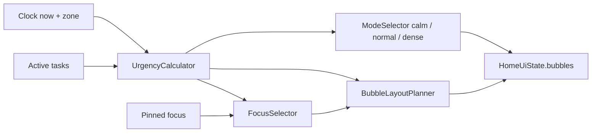

# 08 - Home Engine Specification

Defines how Home decides what to show, how big, and where. All logic here lives in `domain/logic` as pure Kotlin and MUST be unit tested.

## 1. Inputs and outputs

Input: all tasks with `deletedAt == null`. Done tasks completed **today** are kept for the "receded" row and progress; older done tasks are ignored on Home.

## 2. Urgency score

`score = timePoints + priorityPoints + statusPoints`, an integer 0-100+. Computed only for non-done tasks.

### timePoints

| Condition (now = injected clock) | Points |
|----------------------------------|--------|
| Overdue (deadline < now) | 60 |
| Due within the next 3 hours | 55 |
| Due later today | 45 |
| Due tomorrow | 30 |
| Due in 2-3 days | 18 |
| Due in 4-7 days | 8 |
| Due beyond 7 days | 2 |
| No deadline | 3 |

### priorityPoints

| Priority | Points |
|----------|--------|
| HIGH | 25 |
| MEDIUM | 12 |
| LOW | 0 |

### statusPoints

| Status | Points |
|--------|--------|
| IN_PROGRESS | 8 |
| NOT_STARTED | 0 |

### Tier

| Score | Tier | Meaning |
|-------|------|---------|
| >= 70 | XL | Critical (overdue or due today and high priority) |
| 45-69 | L | Important |
| 25-44 | M | Soon |
| < 25 | S | Background |

`isUrgent = score >= 45`.

### Worked examples (must be in tests)

| Case | Calculation | Score | Tier |
|------|-------------|-------|------|
| "Persiapan UTS", HIGH, due today 23:59 (now 14:00) | 45+25+0 | 70 | XL |
| "Tugas Individu", MEDIUM, due today 23:59 | 45+12 | 57 | L |
| "Evaluasi Proker", MEDIUM, due tomorrow | 30+12 | 42 | M |
| "Minum air", LOW, no deadline | 3+0 | 3 | S |
| Overdue MEDIUM, in progress | 60+12+8 | 80 | XL |
| LOW, due in 5 days | 8 | 8 | S |

Tie-break (stable, deterministic): higher score, then earlier deadline (null last), then higher priority, then earlier `createdAt`, then lower `id`.

## 3. Focus selection

1. If a manual pin exists for **today's date** and the pinned task is still active, that task is the focus.
2. Otherwise the highest-ranked task by the tie-break order.
3. If there are no active tasks, no focus.

The focus bubble is always rank 0 and gets the focus styling and label "Fokus sekarang". Pin is cleared automatically when the date changes or the task is done.

## 4. Visible bubbles

- Maximum **7** bubbles shown.
- If more than 7 active tasks: show ranks 0-5 plus an **overflow bubble** "+N lainnya" in slot 6 (always size S). Tapping it navigates to Tasks (same as swipe up).
- Done-today tasks are NOT in the main field; they appear as small receded dots along the bottom edge of the field (max 5, then "+N").

## 5. Layout planner

Deterministic, slot-based (no physics, no randomness except a seeded blob variant and drift phase).

### Field

- Field width `W` = screen width minus 2 x 20dp padding.
- Field height `H = 0.95 * W` (approx. square-ish but never visibly gridded). Planner outputs positions in **normalized coordinates** (0-1 of W and H) and diameters as fraction of W, so it is testable without Compose.

### Slot templates (rank to slot)

| Rank | Center (x, y) | Max diameter (fraction of W) |
|------|---------------|------------------------------|
| 0 | (0.34, 0.30) | 0.54 |
| 1 | (0.76, 0.42) | 0.40 |
| 2 | (0.27, 0.74) | 0.38 |
| 3 | (0.71, 0.80) | 0.30 |
| 4 | (0.86, 0.13) | 0.22 |
| 5 | (0.55, 0.94) | 0.20 |
| 6 | (0.10, 0.52) | 0.18 |

### Diameter

`diameter = min(tierDiameter, slotMax)` where:

| Tier | tierDiameter (fraction of W) |
|------|------------------------------|
| XL | 0.54 |
| L | 0.40 |
| M | 0.30 |
| S | 0.20 |

Rank 0 is always at least tier L size even if its score is low (so the focus is always prominent). Then multiply by the **mode scale** (§6).

### Overlap rule

Slot centers and diameters are chosen so adjacent bubbles overlap by at most 12% of the smaller diameter. Astra MUST add a unit test that checks pairwise overlap for the 7-slot template at all diameters at their maxima, and tweak slot coordinates (documenting the changes in `STATUS.md`) if the test fails. The spec numbers above are the starting point.

### Blob shape and drift

- Blob variant = `taskId % 4` (see `07` §5).
- Drift phase = `(taskId * 37) % 360` degrees; period = `6000 + (taskId % 5) * 1000` ms; amplitude 3dp (x and y, 90 degrees apart).
- Drift disabled for: reduced motion, app not RESUMED, field with lifecycle stopped.

## 6. Modes

| Mode | Condition | Effect |
|------|-----------|--------|
| CALM | urgent count == 0 (and at least one task exists, or all done) | Mode scale 1.0. Background tint shifts to a soft mint wash (light `#EAF6EF` / dark `#1B2A27`) over 600ms. Greeting line: "Semua aman. Tarik napas dulu." (all done) or "Belum ada yang mendesak." Bubbles use calmer drift (amplitude 2dp). |
| NORMAL | urgent count 1-2 | Mode scale 1.0. Default background. |
| DENSE | urgent count >= 3 | Mode scale 0.9; slightly warmer coral wash behind the field (light `#FFF1EC` / dark `#2A2022`) at low alpha; greeting line: "Ada {n} hal penting hari ini." Do not add any alarm sound or flashing. |

Only transitions that change mode animate; the planner remains deterministic per mode.

## 7. Bubble content

| Element | Rule |
|---------|------|
| Title | Max 2 lines, ellipsis. Font: `titleMedium` for tiers XL/L, `titleSmall` for M, hidden for S unless tapped (S shows first word or first 8 chars with ellipsis; full title on tap and via TalkBack) |
| Secondary | Only for XL and L: one short deadline label, e.g. "Hari ini, 23.59", "Besok", "Terlambat". |
| Flag | Coral flag icon at the top-right of the bubble when priority HIGH and tier is L or XL |
| Domain cue | Fill/outline color from the domain accent |
| In progress | Small half-moon indicator at the bottom |
| Receded | See `07` §3 |

## 8. Next obligation pill

Shows the nearest of:
- the next **event** starting within 24 hours, or
- a task with a **time-specific** deadline (`hasDeadlineTime`) within 24 hours.

Format: "{HH.mm} {title}" with a small kind icon. Hidden if none.

## 9. Progress

- `total` = tasks with deadline today (not deleted) + tasks completed today + active tasks marked IN_PROGRESS without a deadline.
- `done` = of those, status DONE.
- Display "{done} dari {total} selesai". If total is 0, hide the strip and show the empty state instead.

## 10. Interaction contract

| Action | Behavior |
|--------|----------|
| Tap bubble | Open peek sheet |
| Long press | Mark done (haptic `CONFIRM`), run completion animation |
| Mark done | Repository sets DONE + completedAt; the flow re-emits; planner reflows; bubble animates to receded state before leaving the field |
| Quick add | After save, new bubble animates in; reflow is spring-based |
| Undo (Snackbar "Dibatalkan?") | Appears after completing from Home; restores status |

Time ticks: `HomeViewModel` re-evaluates scores at least every 60 seconds and at every date change so overdue transitions happen without user action.

## 11. Edge cases

| Case | Behavior |
|------|----------|
| 0 tasks | Empty state per `01` §12 |
| 1 task | Rank 0 only, centered slot 0, mode by urgency |
| All tasks done | Calm mode; receded dots; message "Semua beres." |
| Very long title | 2 lines, ellipsis |
| Two tasks, identical scores | Tie-break rule, deterministic |
| Date rolls over at midnight | Recompute buckets, clear pin |
| Font scale 200% | Bubble minimum diameter 72dp; S bubbles may show icon only; if text cannot fit in XL/L, reduce to 3 bubbles + overflow |
| Timezone/DST change | Everything recomputed from zone each tick |

## 12. Test matrix (minimum)

- Every row of every table in §2 (parameterized).
- Tie-break ordering.
- Pin override and pin expiry.
- 0, 1, 7, 8, 20 tasks (overflow behavior).
- Mode selection at urgent counts 0, 1, 2, 3, 6.
- Layout determinism: same input gives same output.
- Overlap and bounds checks (§5).
- Midnight rollover with a fake clock.
