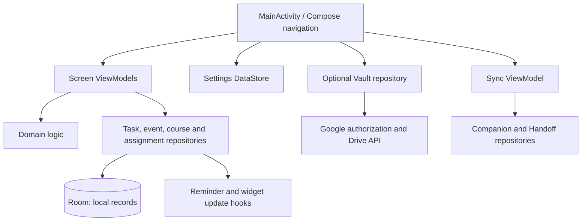
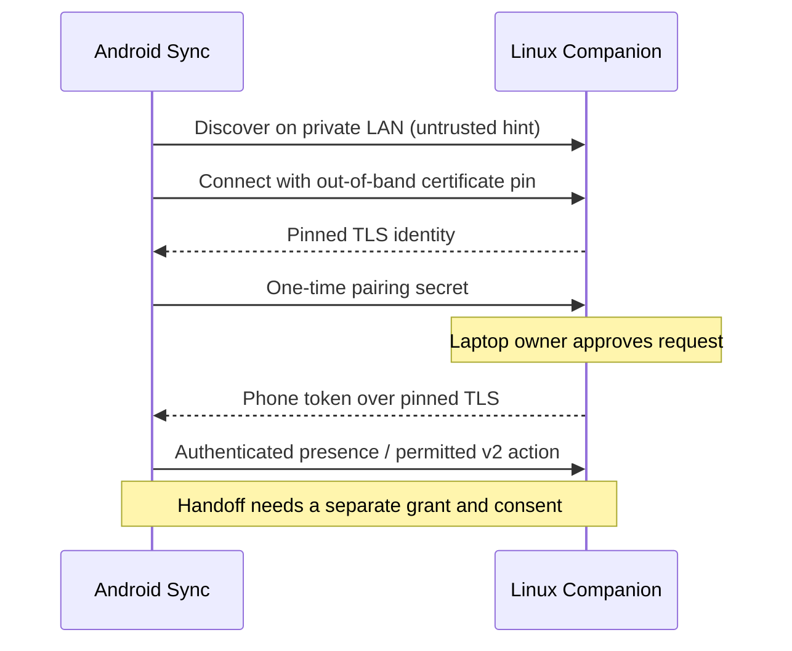

# Architecture

Riko Hub has a local Android planner and an optional foreground Linux Companion. The Android app can work with its own records offline. Network features cross explicit boundaries: Google Drive for selected materials and a paired laptop for presence and handoff. This page describes **source in the current working tree**; it does not assert a successful build or device run.

## Android: local core

The repository has one Gradle Android module, `:app`. `MainActivity` starts the Compose app. `RikoNavHost` connects Home, Tasks, Timeline, Vault and Sync; course and assignment UI is also present in the current unverified working tree. Screen ViewModels observe repositories. Domain logic computes grouping, urgency, recurrence, timeline stops, reminder choices and widget presentation. `AppContainer` wires these pieces manually and supplies an injectable clock.

Room entities and DAOs live under `data/local/`; repository classes map storage into domain models and expose local state to the UI. The current working tree declares Room schema version 4 with explicit migrations 1→2, 2→3 and 3→4. The latter course and assignment changes are **IMPLEMENTED / UNVERIFIED** source, including their backup integration; owner-run migration and restore evidence is still needed. Settings use DataStore. Reminder scheduling and widget updates are separate side effects of task changes. [Project structure](04_PROJECT_STRUCTURE.md) identifies the files.

Schema evidence for contributors

The checked-in `app/schemas/` directory currently contains exports for versions 1 and 2. The v0.6 [course](../V06_COURSE_SPACES.md) and [assignment](../V06_ASSIGNMENT_LIFECYCLE.md) phase notes call for the owner to generate and inspect authentic version 3 and 4 exports during their build and migration checks. Do not create schema snapshots by hand or infer a successful upgrade from migration source alone.

## Optional external boundaries

The Materials Vault uses Google authorization and Drive APIs for selected files. Local planner records do not depend on Drive login and are not automatically uploaded there. OAuth and file access need live owner verification; a successful compile cannot establish Drive consent or provider behavior. See [Drive setup](../DRIVE_SETUP.md).

The Sync screen owns the phone-side Companion relationship. Protocol 1 provides private-LAN discovery, pinned HTTPS pairing, token-authenticated recent presence and revocation. The Android trust record is encrypted with Android Keystore in private preferences, separate from Room and ordinary backups. The laptop keeps a persistent certificate and hashed phone tokens in an owner-only data directory. Discovery names and addresses are hints; the certificate pin and peer identity decide trust. Android currently holds one trusted laptop record. There is no remote/Tailscale transport in source.

Protocol 2 adds bounded, foreground **LAN** handoff in source. A separate phone grant and per-transfer consent limit access. Selected files use Android’s storage access framework (SAF), chunk and whole-file hashes, and controlled Linux staging. Text is explicit and short lived; workspace entries are metadata only. The Companion does not expose the Android Room database, arbitrary paths or a shell endpoint. Build, runtime and cross-device acceptance are pending. See [protocol 1](../V04_COMPANION_PROTOCOL.md) and [protocol 2](../V05_HANDOFF_PROTOCOL.md).

The Linux package provides `rikohub`, a curses dashboard, an explicit-bind foreground HTTPS server, state and storage, and handoff logic. It advertises on the selected private IPv4 interface with DNS-SD. There is no daemon or automatic startup in this repository.

## Ownership and proposed evolution

The phone’s Room planner is the local source of truth. Existing JSON backup is an explicit export; it is not live database synchronization. A Drive file ID or SAF URI is a reference whose access can change. Handoff creates selected copies and metadata without making the laptop a second planner writer.

The [Renaissance architecture](../renaissance/08_ARCHITECTURE_AND_SECURITY.md) proposes remote private routing, portable context, typed links, recovery and eventually considered structured sync. Those contracts are **PLANNED**, not current modules or permissions. A later sync design needs conflict, deletion and restore rules before implementation. See the [roadmap](02_ROADMAP.md) for sequencing.

[Start here](00_START_HERE.md) · [Structure](04_PROJECT_STRUCTURE.md) · [Features](01_FEATURES.md)
