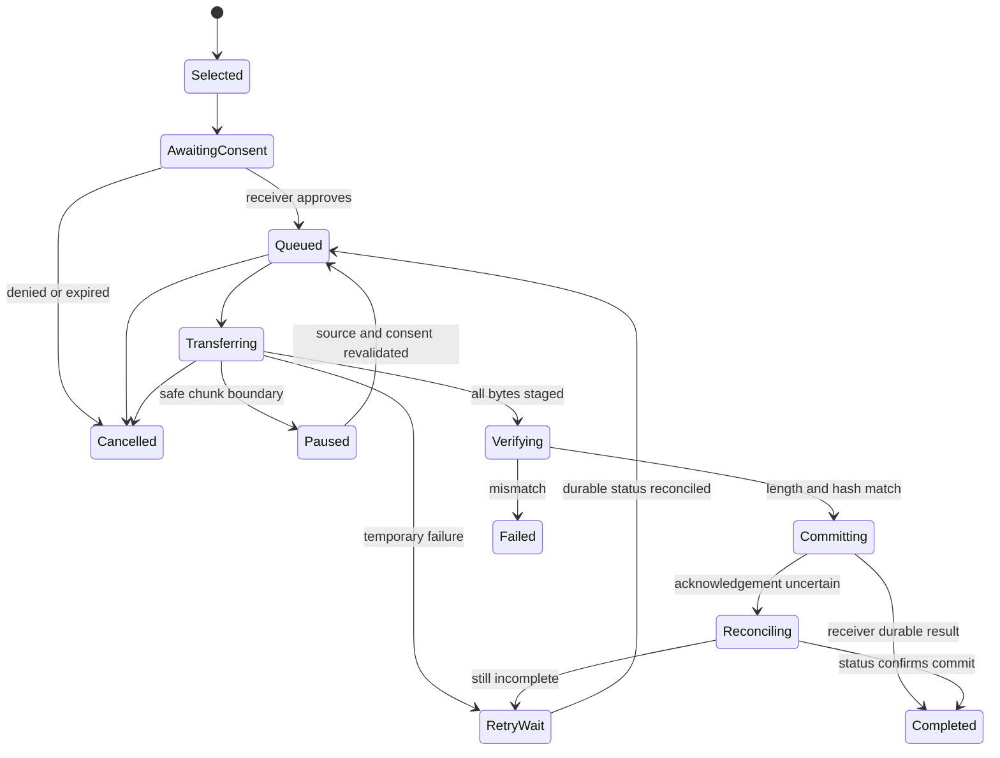

# 05 — v0.5 Sync and Handoff

**Status:** Proposed direction only. No file transfer, clipboard transfer, record sync, or remote companion endpoint is implemented. The current v0.4 source protocol is presence-only and caps JSON bodies at 8 KiB; end-to-end acceptance remains unconfirmed. See [V04 protocol 1](../V04_COMPANION_PROTOCOL.md) and [remote access proposal](04_V04_REMOTE_COMPANION.md).

## Product boundary

A handoff is a user-selected copy between the phone and the Linux companion. The phone initiates HTTPS for both upload and download; the phone does not expose an inbound server. Linux serves only its explicitly approved private listeners. The feature never copies or merges the Room SQLite database. A transfer does not imply structured record synchronization, shared editing, or a claim that work was submitted elsewhere. Local records remain usable if the laptop, LAN, or overlay is unavailable.

Every transfer has a deliberate source, destination, preview, and final action. On Android, the user selects an exported document destination through Storage Access Framework (SAF), or accepts a file into app-private staging before choosing where to save it. On Linux, the owner chooses a configured safe destination directory. The receiver must not accept arbitrary paths, follow symlinks outside the configured root, launch files, or overwrite an existing file without approval. Receiving files requires a per-peer transfer capability and explicit per-transfer approval; a global companion token must not silently grant file access.

Clipboard support is a separate explicit action: press Send on the chosen device and direction, show what will be sent, and apply a short lifetime and size cap. There is no background clipboard monitor, hidden polling, or password detection claim. The app cannot reliably identify every password or secret, so the preview and deliberate action are the protection.

## Proposed transfer protocol

Keep protocol 1 presence-only. Android's `verifyPeer` currently requires the exact capability array `['presence']`; adding capabilities to a protocol 1 response would cause current phones to reject it. A transfer-capable service therefore needs a separately negotiated protocol version or an explicitly versioned extension with strict compatibility rules. Do not silently change the v1 capability list or its 8 KiB JSON body limit.

A proposed bounded API consists of create/preview, consent, status, chunk, commit, and cancel operations. The phone starts and polls transfers in either direction; Linux may enqueue a prepared download for the phone to accept, but never initiates an inbound Android connection. Every request remains authenticated, peer-bound, bounded, and idempotent. Authorization is checked on all routes and again before each state-changing operation. Revoking a peer immediately blocks create, chunk, commit, and status access.

A manifest contains a transfer ID, direction, peer ID, content identifier, expected byte size, bounded display name, declared MIME type, and SHA-256 of the complete content. Treat names and MIME values as display metadata, sanitize them for the destination, and never trust them as filesystem paths or content identity. Hashes detect corruption; they do not prove who created the file.

Chunking is proposed at 256 KiB with a conservative 1 GiB per-file and 2 GiB queued-data ceiling, one active transfer per device, and explicit device/storage budgets. These are design limits for review, not performance promises; revise them only with measured Android device, Linux disk, and network behavior. Binary chunks use a separate request budget from the existing 8 KiB JSON control messages. Reject oversized, overlapping, out-of-order, or incorrectly bound chunks before writing them.

Transfer IDs are idempotent and bound to peer, direction, manifest, and content hash. Persist the acknowledged offset only after the chunk is durable. On restart, query status and resume from the server-acknowledged offset; never assume the client's last sent byte was stored. If the source changes, the manifest hash no longer matches and resume must stop with a clear restart path. Queue metadata may persist; do not copy the Room database as a shortcut.

### Proposed messages and compatibility

This is a draft **protocol 2** contract for ADR-03, not an addition already supported by `Handler`. Keep `/v1/*` unchanged for older clients. After pinned TLS, a new client may probe `GET /v2/hello`; a 404 means handoff is unavailable, not permission to send binary data to v1. A v2 reply identifies `protocol:2`, the same peer UUID, recognized capability names and bounded negotiated limits. Unsupported versions stop with an actionable message. Unknown optional capabilities are not granted automatically. Pairing can retain the existing v1 procedure; v2 protected routes still require the paired bearer token and server-side action consent.

Example one-file manifest:

```json
{
  "protocol": 2,
  "transfer_id": "8cc97a33-1f3b-4c25-9ef3-1d02b6370138",
  "direction": "phone_to_laptop",
  "content_id": "040db2b6-c4c4-4e91-b23e-a69e61b91e8c",
  "display_name": "lab-report.pdf",
  "mime_type": "application/pdf",
  "size_bytes": 524288,
  "sha256": "<64 lowercase hexadecimal characters>",
  "destination_id": "<receiver-issued approved destination identifier>"
}
```

The placeholders are schema notation, not executable fixture data. The server derives the peer from authentication rather than accepting an arbitrary request peer ID. Content IDs refer to selected files, not permission to browse other files. No client absolute path is accepted. Bound each control document to 8 KiB and each batch to a proposed 100 files; process manifests individually rather than create an unlimited JSON batch. Bound display names/MIME metadata and reject malformed IDs, negative sizes and unknown required fields.

| Proposed route | Contract and ownership |
|---|---|
| `POST /v2/transfers` | Create an idempotent manifest; initial state waits for receiver consent. Reusing an ID with different content returns conflict. |
| `GET /v2/offers` | Return a bounded page of this peer's explicitly prepared Linux offers only. Never enumerate arbitrary directories. |
| `POST /v2/transfers/{id}/consent` | Record Android receipt consent for a prepared download. Linux receipt approval is a local companion action, not a remote client approving itself. Bind consent to manifest hash, action and selected destination. |
| `GET /v2/transfers/{id}` | Return durable state, acknowledged offset, expected manifest hash and bounded error code. A different authenticated peer cannot inspect it. |
| `PUT /v2/transfers/{id}/chunks?offset=N` | Upload at the exact durable offset; bounded binary body and chunk hash. Identical retries are acknowledged; differing bytes conflict. |
| `GET /v2/transfers/{id}/chunks?offset=N&length=L` | Download selected bytes within negotiated bounds after consent. Source descriptor belongs to the approved offer, never a request path. |
| `POST /v2/transfers/{id}/ack` | Android receiver acknowledges only bytes durably staged locally; this is not final destination completion. |
| `POST /v2/transfers/{id}/commit` | Idempotent finalization. Linux verifies uploaded data. Android verifies downloaded data and its selected destination before acknowledging completion. Record which receiver performed verification. |
| `POST /v2/transfers/{id}/cancel` | Stop uncommitted work and clean staging under retention policy; return the actual state if already committed. |

All routes recheck paired authentication, ownership, revocation and consent. Expired consent cannot resume silently. Use 401 for revoked authentication, 403 for missing consent, 409 for offset/manifest/conflict state, 413 for limits, 422 for integrity failure, 426 for protocol incompatibility and a bounded retryable error for temporary storage/service problems. Do not include content or paths in error logs.

### Queue and state transitions



Cancel is valid only before final commit; a request racing commit enters reconciliation. A failed transfer preserves the source and offers explicit restart or cancel. Use bounded status checks only while the transfer UI/approved transfer work is active, with backoff; no continuous background polling. MVP transfers are foreground-scoped. A later user-visible foreground transfer mode or WorkManager continuation requires a separate Android-policy and notification review; no promise of uninterrupted background transfer is made.

Store peer ID, transfer ID, source content reference, manifest hash, state, acknowledged offset, destination handle, retry count and expiry. Do not persist bearer tokens in the queue. Persist SAF URI permission only where the provider offers it. Revalidate grants, source hash and seekability after restart. A non-seekable or changed source requires an explicit restart, or an owner-approved private staging copy with sufficient reserved space; it must not pretend to resume.

Reserve storage before receiving, including staging plus destination-copy overhead on Android. Unknown-size sources need a bounded size-discovery/staging step or rejection with guidance. Reject requests whose actual byte count exceeds the declaration or quota. Clean abandoned partial files by a disclosed TTL and manual control. Completion history and file retention are separate controls. Android document providers may leave a partially created document if deletion fails; name that output and explain recovery rather than claim atomicity.

### Workspace and clipboard handoff

Initial context contains an existing Task `syncId`, a small read-only title/deadline snapshot with timestamp and canonical field fingerprint, selected content IDs/checksums and pending transfer IDs. It does not depend on future Course/Note/Graph schemas. Linux can present a lightweight read-only context list and explicitly open a selected available document through an OS viewer. Compare fields/fingerprint on return; timestamps alone do not establish freshness or resolve conflicts. No task mutation is sent back until structured sync is designed. Later course/ledger context is versioned enrichment.

For optional clipboard handoff, propose a 64 KiB UTF-8 limit, five-minute expiry and one item per deliberate action, pending owner review. Text is previewed at source and receiver. Reading or writing the clipboard requires the relevant visible action and current platform permission; expiry/history must not retain its text. Empty, oversized, sensitive or unsupported content is rejected or canceled without silently falling back to file transfer.

## Commit, cancellation, and recovery

Stage received bytes in a private controlled location. Verify total length and end-to-end SHA-256 before exposing the result. On Linux, flush staged content and atomically rename within the same filesystem into the approved destination. Android SAF providers do not guarantee atomic rename; use private staging, copy and verify the destination where possible, then report accurately if cleanup or verification is incomplete. A failure must preserve the source and remove or clearly label partial output. Never claim a complete transfer based only on chunk acknowledgements.

Commit must be idempotent. A cancellation that races commit can have an uncertain outcome; the client queries the transfer ID and reports the durable result rather than guessing. A completed transfer is not undone by cancellation. If a destination name already exists, default to Keep both with a generated safe name; replacing content requires a separate clear approval. Do not silently overwrite or deduplicate by hash.

The user can inspect transfer history and delete its metadata under a documented privacy retention rule. History should say whether the transfer completed, was canceled, failed verification, or remains incomplete. It should not retain file contents, bearer tokens, pairing secrets, or unnecessary absolute paths. Disk-full, process death, app pause, network loss, peer revocation, and user cancellation each need an actionable status and safe retry behavior.

## Structured synchronization is later work

Record synchronization is a different feature and remains deferred. It needs stable entity IDs, operation IDs, causal revisions or base versions, tombstones, acknowledgements, tombstone-retention rules, conflict UI for concurrent edits and deletion, backup behavior, migration rules, and recovery from device clock skew. Last-write-wins based only on timestamps is insufficient: clock skew and concurrent edits can silently lose user work. Until a separate ADR defines these semantics, do not call file handoff “sync” in UI copy or merge whole databases.

Draft structured-sync states for ADR-04 are `DISABLED`, `DIRTY_LOCAL`, `NEGOTIATING`, `EXCHANGING`, `REVIEW_CONFLICT`, `APPLYING`, `ACKNOWLEDGED` and `RECOVERY_REQUIRED`. This state model is a design prerequisite, not an enabled engine. A batch validates schema/capabilities and base revisions before an atomic local apply; acknowledgment follows durable commit. Duplicate operation IDs have no repeated effect. Unsupported schema or a missing causal base stops before mutation.

Concurrent edits to the same task require preserving both revisions and explicit reconciliation; disjoint fields may merge only under a documented semantic rule. Delete-versus-edit requires a visible choice and retained tombstone until participating devices acknowledge it or the owner retires them. An old offline device must not resurrect a deleted record automatically. Recurrence generation needs one canonical successor identity, not two timestamp winners. Files are versioned separately from record edits; equal task IDs do not authorize overwriting associated files. Test fixtures must cover skewed clocks, delayed devices, duplicate operations and interrupted commits before sync is considered for a release.

The product vision and relationship model are in [02 Product Vision](02_PRODUCT_VISION.md) and [06 Signature Features](06_SIGNATURE_FEATURES.md); proposed academic workflows are in [07 Academic and Automation](07_ACADEMIC_AND_AUTOMATION.md). Protocol, trust, storage, and threat boundaries are in [08 Architecture and Security](08_ARCHITECTURE_AND_SECURITY.md). The [roadmap](03_MASTER_ROADMAP.md) and [execution backlog](09_EXECUTION_BACKLOG.md) govern sequencing and implementation authorization.
